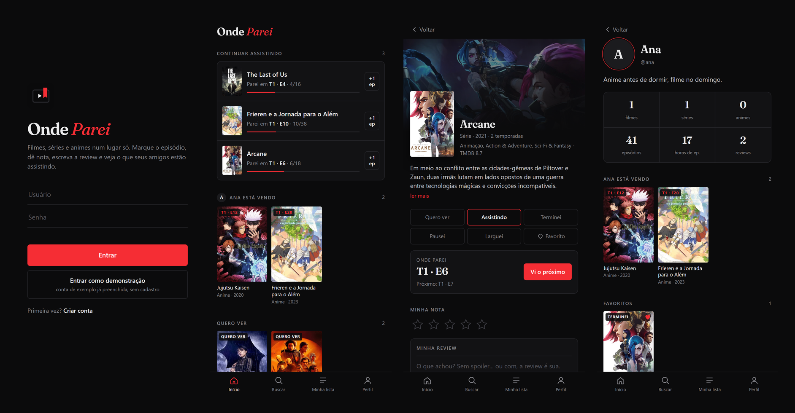

# Onde Parei

App de celular para quem vê muita coisa ao mesmo tempo: filmes, séries e animes num lugar só, com o episódio onde você parou, nota, review e o que seus amigos estão assistindo.

**Testar agora (sem cadastro):** https://onde-parei.pages.dev/?demo



## O que faz

- **Busca** no catálogo da TMDB (filmes, séries e animes, em português), com filtro por tipo.
- **Onde parei:** temporadas e episódios de cada série. Dá pra marcar um por um ou usar "até aqui", que marca tudo até aquele episódio de uma vez. O início mostra o que está em andamento, com barra de progresso e um botão **+1 ep** que passa sozinho pra próxima temporada quando a atual acaba.
- **Status automático:** quero ver, assistindo, terminei, pausei ou larguei. Vira "assistindo" no primeiro episódio e "terminei" no último.
- **Nota** de meia em meia estrela, **review** e **favoritos**.
- **Amigos:** perfil de cada pessoa, "Fulana está vendo" no início, e na página de cada título as reviews, notas e onde cada amigo parou.
- **Onde assistir:** streamings com o título no Brasil (dados da JustWatch via TMDB). O app não exibe nem indica conteúdo pirata.
- **Perfil** com foto (recortada e reduzida no próprio aparelho), estatísticas, favoritos e reviews.
- **Instala no celular** como app (PWA), no Android e no iPhone, sem loja.
- **Modo demonstração:** botão na tela de entrar (ou `?demo` no link) que abre uma conta de exemplo já preenchida, com uma amiga fictícia. Os dados de exemplo se refazem sozinhos.

## Como foi feito

| Parte | Tecnologia |
|---|---|
| Telas | HTML, CSS e JavaScript puro, sem framework; roteamento por hash |
| App instalável | PWA: `manifest.webmanifest` + service worker (rede primeiro, cache como reserva) |
| API | Cloudflare Pages Functions (`worker.js`, publicado como `_worker.js`) |
| Banco | Cloudflare D1 (SQLite): `usuarios`, `itens`, `vistos`, `meta` |
| Login | Senha com PBKDF2 (100 mil iterações, sal por usuário); token assinado com HMAC-SHA256 e preso à conta |
| Dados de filmes | API da TMDB, chamada só pelo servidor (a chave nunca vai pro navegador) |

Algumas decisões:
- O catálogo não é copiado pro banco. O app guarda só o que é do usuário (status, nota, review, episódios vistos) e busca o resto na TMDB na hora.
- "Onde parei" sai dos episódios marcados (o maior temporada/episódio visto). Desmarcar um episódio corrige sozinho.
- O token leva a data de criação da conta, que é conferida no banco a cada pedido. Assim uma conta apagada não deixa sessão válida pra quem herdar o mesmo id.
- No PC, os carrosséis ganham setas e dá pra arrastar com o mouse; arrastar não abre o pôster por engano.

## Rodar localmente

```sh
# crie .dev.vars com:
#   TMDB_TOKEN=sua_chave_da_tmdb
#   SEGREDO=qualquer_texto_aleatorio
npx wrangler dev
```

## Publicar

```sh
npx wrangler d1 create onde-parei-portfolio      # coloque o database_id em wrangler.jsonc e pages/wrangler.jsonc
npx wrangler pages secret put TMDB_TOKEN --project-name onde-parei
npx wrangler pages secret put SEGREDO --project-name onde-parei
sh publicar.sh
```

---

Este produto usa a API da TMDB, mas não é endossado nem certificado pela TMDB. Disponibilidade de streaming: JustWatch.
